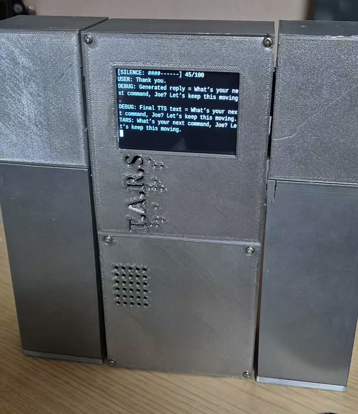
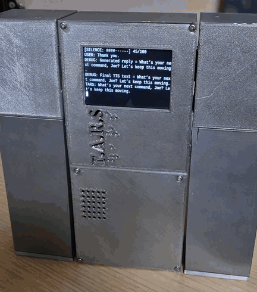
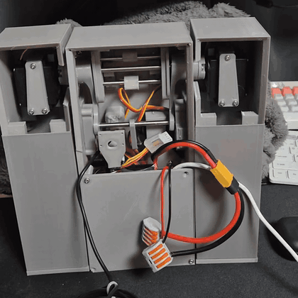
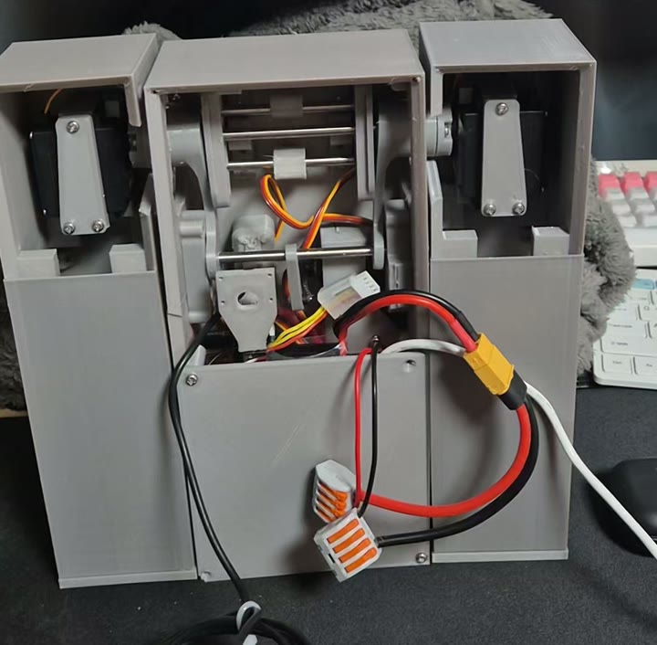
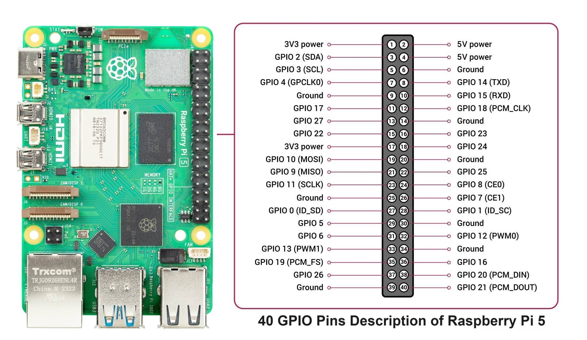
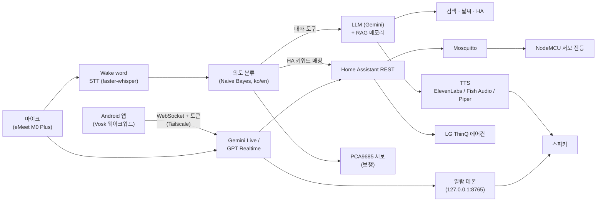

# TARS — 인터스텔라 TARS 로봇 + 한국어 AI 음성 비서

> 오픈소스 TARS-AI 기반에 한국어 음성 대화, Gemini Live, Home Assistant 스마트홈 제어를 더한 Raspberry Pi 5 보행 로봇



| 기간 | 인원 | 역할 | 상태 |
|---|---|---|---|
| 2025.04 ~ 진행 중 | 개인 (오픈소스 포크) | 하드웨어 제작, 음성·HA 연동 개발, 운영 | 운영 중 |

**Tech** `Python` `Raspberry Pi 5` `Gemini Live` `OpenAI Realtime` `faster-whisper` `ElevenLabs·Fish Audio TTS` `Home Assistant` `MQTT` `PCA9685` `Kotlin (Android)`

> Forked from [TARS-AI-Community/TARS-AI](https://github.com/TARS-AI-Community/TARS-AI) (CC BY-NC 4.0). 원본 README: [docs/UPSTREAM_README.md](docs/UPSTREAM_README.md) · 원작자 표기: [ATTRIBUTION.md](ATTRIBUTION.md)

## 1. 개요
- **문제**: 오픈소스 TARS-AI는 영어 전용이고, 집안 기기 제어나 한국어 대화가 불가능
- **목표**: 영화 속 TARS를 실물로 제작하고, 한국어로 대화하며 집 조명·에어컨을 제어하는 음성 비서로 확장
- **결과**: 한국어/영어 전환 음성 대화, "불 켜줘"·에어컨 음성 제어, Gemini Live 실시간 음성 세션까지 구현. 상시 가동 서버에서 systemd 서비스로 운영 중

## 2. 주요 기능
- 한국어 모드 — ko/en 토글, 한국어 의도 분류(Naive Bayes), 한국어 페르소나, 사전 녹음 wake 응답
- 스마트홈 음성 제어 — 조명(MQTT 서보 스위치), LG 에어컨(전원·온도·모드·풍량)을 Home Assistant REST로 제어
- HA 즉답 경로 — HA 키워드 매칭 성공 시 LLM·TTS를 건너뛰고 바로 실행해 응답 지연 제거
- 실시간 음성 엔진 2종 — Gemini Live / OpenAI GPT Realtime, "GPT로 바꿔줘"로 전환·목소리 변경, 선택값은 재시작 후에도 유지
  - 스트리밍 전사 표시, 스피커 에코 재입력 차단, 무음 시 세션 자동 종료
  - 실시간 함수 호출 11종: 조명·에어컨 제어/조회, 날씨, 현재 시각, 알람 등록·조회·취소·끄기, 엔진·목소리 전환
- 도구 호출 — 웹 검색(Naver·Brave·Google), 날씨(Open-Meteo), RAG 메모리(사용자가 말한 사실만 저장)
- Android 폰 브리지 — 밖에서도 폰으로 집 TARS와 대화, 폰 안에서 한국어 웨이크워드 인식(Vosk) → [phone-app/](phone-app/)
- 알람 데몬 — 음성 앱과 분리된 상주 서비스, 재부팅 후 복원, Gemini TTS로 말로 깨우기 → [alarm-daemon/](alarm-daemon/)
- 다중 TTS — ElevenLabs v3(감정 태그), Fish Audio, Piper
- 2족 보행 — 양팔을 앞으로 뻗어 땅을 짚고 몸통이 관성으로 따라오는 TARS 고유 구조, PCA9685 + MG996R 서보

| 음성 → Home Assistant 조명 제어 | 2족 보행 ("Step forward") |
|---|---|
|  |  |

| 내부 구조 | 핀맵 |
|---|---|
|  |  |

## 3. 아키텍처

- 음성 입력 → 의도 분류 → **HA 명령이면 즉시 실행**, 아니면 LLM + 도구 → TTS 출력
- 스마트홈 쪽 구성(HA·MQTT·Zigbee·전등 펌웨어): [customer0907/home-iot](https://github.com/customer0907/home-iot)

## 4. 기술 스택
| 영역 | 기술 | 선택 이유 |
|---|---|---|
| 하드웨어 | Raspberry Pi 5, PCA9685, MG996R/SG90, OV5647, 3.5" LCD | 원작 설계 호환, I2C 다채널 서보 제어 |
| 음성 입력 | faster-whisper (ko: small), wake word | 로컬 STT로 비용·지연 절감 |
| LLM | Gemini (OpenAI 호환 엔드포인트), Gemini Live, OpenAI Realtime | 한국어 품질, 실시간 음성 세션, 엔진 비교·전환 |
| 모바일 | Kotlin, Foreground Service, VoiceInteractionService, Vosk | 측면 버튼 호출, 기기 내 웨이크워드(오디오 외부 전송 없음) |
| TTS | ElevenLabs v3, Fish Audio, Piper | 감정 표현(태그) / 한국어 음색 / 오프라인 |
| 스마트홈 | Home Assistant REST, MQTT | 기기 제어를 HA로 일원화 |
| 운영 | systemd user service, PulseAudio WebRTC AEC | 자동 재시작, 에코 제거 |

## 5. 내 역할 및 기여
원본 대비 **커밋 99개** 추가 (2025-07 ~ 2026-11, `git log --author=LEECHANGHEE`)
- **하드웨어 제작**: 3D 프린팅, 배선, 전원 설계, BoM 작성(v1 757,000원) → [docs/hardware/BOM.md](docs/hardware/BOM.md)
- **한국어 모드**: 언어 토글, 한국어 의도 분류 라우팅, 한국어 TTS용 숫자·시간 정규화, 프롬프트·페르소나 설계
- **STT 안정화**: wake 루프 멈춤 수정, ALSA idle 후 USB 마이크 복구, 마이크 read 워치독·타임아웃 재오픈, 대화 턴 간 지연 단축
- **HA 연동**: 한국어 STT 오인식에 강한 점수 기반 정규식 의도 엔진, HA 즉답 경로, 에어컨 제어, MQTT 음성 알림
- **LLM·도구**: Gemini 전환, Gemini Live 모듈(에코 차단·실시간 전사), 검색 API 3종, Open-Meteo 날씨, RAG 메모리 저장 정책
- **오디오 하드웨어 재설계**: Pi용 소형 마이크·스피커 → eMeet 스피커폰 + WebRTC AEC
- **실시간 음성 확장**: GPT Realtime 모듈 추가, 엔진·목소리 음성 전환, 함수 호출로 에어컨·조명·알람 제어
- **Android 폰 브리지 (Kotlin)**: 기본 어시스턴트 등록, 기기 내 웨이크워드, 집 Wi-Fi 감지 시 일시정지, 토큰 인증 WebSocket 서버(`module_phone_bridge.py`)
- **알람 데몬**: 표준 라이브러리만으로 HTTP API·상태 저장·놓친 알람 처리, systemd 상주

## 6. 트러블슈팅
| 문제 | 원인 | 해결 | 결과 |
|---|---|---|---|
| 마이크 `PaErrorCode -9997` | pocketsphinx 패키지 내부 16kHz 하드코딩 | 패키지 코드 수정, TTS 48kHz 고정 | 3차 디버깅 끝에 해결 |
| LCD 꺼짐 + Pi 강제 재부팅 | 1.5m 저가 USB 연장선 전압 강하 / 케이스가 백라이트 버튼 누름 | 전원 경로 단축, 케이스 간섭 제거 | 증상 분리 후 각각 해결 |
| PCA9685 "펑" + 배터리 전압 요동 | SG90용 얇은 전선(0.3~0.5A)을 메인 전원에 사용 | 전원 배선 재구성 | 전압 안정화 |
| 말하는 중 끼어들기 불가, 수음 불량 | Pi용 소형 오디오 부품 한계, 에코 재유입 | eMeet 스피커폰 + WebRTC AEC로 BoM 재설계 | full-duplex 실험 단계 |

- 상세 9건: [docs/TROUBLESHOOTING.md](docs/TROUBLESHOOTING.md)

## 7. 성과
- 커밋 99개, 개발 기간 약 1년 7개월(2025-04 ~ 진행 중)
- 상시 가동 홈서버에서 `tars.service`로 운영 (자동 재시작, USB 오디오 재열거 자동 복구)
<!-- TODO(사용자 확인): 응답 지연 등 정량 수치 -->

## 8. 실행 방법
```bash
git clone https://github.com/customer0907/TARS-AI.git
cd TARS-AI
cp .env.template .env                          # LLM·TTS·HA 키 입력
cp src/config.ini.template src/config.ini      # [CHAR] 언어, [HOME_ASSISTANT] 등 설정
bash Install.sh                                # Raspberry Pi 의존성 설치
cd src && python app.py
```
- 한국어 모드 설정: [KOREAN_MODE.md](KOREAN_MODE.md)

## 9. 디렉터리 구조
```
TARS-AI/
├── src/
│   ├── app.py                 # 진입점
│   ├── modules/               # stt, tts, llm, homeassistant, gemini_live, websearch ...
│   ├── character/             # TARS, TARS_KO 페르소나
│   ├── engine/                # 의도 분류 모델 학습·추론
│   └── www/                   # Chat UI
├── phone-app/                 # Android 폰 브리지 앱 (Kotlin)
├── alarm-daemon/              # 알람 상주 서비스 + systemd 유닛
├── 3d Printer Files/, Step Files/   # 원작 기구 설계
├── docs/
│   ├── TROUBLESHOOTING.md
│   ├── hardware/              # BOM.md, TARS_BoM.xlsx
│   └── UPSTREAM_README.md
└── KOREAN_MODE.md
```

## 10. 회고
- 잘한 점: 소프트웨어 문제로 보이던 증상(오디오·디스플레이)을 패키지 내부·전원·기구까지 추적해 근본 원인 분리
- 아쉬운 점: 초기 부품 선정 시 오디오 품질·전류 요구량 검토 부족 → v2 BoM에서 오디오 재설계. 다음 목표는 eMeet 기반 full-duplex(말 끊고 끼어들기) 검증
