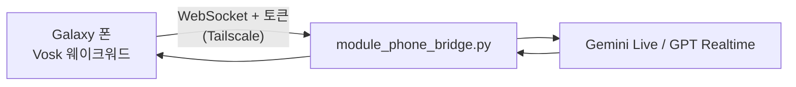

# TARS Phone (Android)

> 밖에서도 폰으로 집의 TARS와 음성 대화하는 안드로이드 앱. 폰은 마이크·스피커만 맡고, 대화는 홈서버의 TARS(Gemini Live / GPT Realtime)가 처리한다.

## 동작
- **기본 어시스턴트 등록**: 측면 버튼 길게 누르기나 모서리 스와이프로 바로 TARS 호출 — `TarsInteraction.kt`
- **웨이크워드 (기기 내 처리)**: Vosk 한국어 모델로 폰 안에서만 인식, 오디오는 밖으로 안 나감 — `WakeSupport.kt`
  - 조용한 구간은 인식기를 건너뛰어 배터리 절약
  - 말 시작 직전 청크를 다시 넣어 앞부분 손실 방지
  - 자주 쓰는 일상어·유사 발음(자비, 차비 등)을 함께 넣어 오인식 감소
  - 집 Wi-Fi에서는 일시정지 (집에서는 데스크톱 TARS가 응답)
- **대화 모드**: 마이크 16kHz PCM을 WebSocket으로 집 TARS에 스트리밍, 응답 음성 재생 — `VoiceService.kt`
  - 포그라운드 서비스 하나로 웨이크·대화 모두 처리 → 화면 꺼진 상태에서도 시작 가능
- **서버 쪽**: [`src/modules/module_phone_bridge.py`](../src/modules/module_phone_bridge.py) — Tailscale IP에만 바인드, 공유 토큰(`hmac.compare_digest`)으로 인증
- **디버그 자가진단**: 녹음 파일을 실제 웨이크 감지기에 통과시켜 결과 표를 로그로 출력 — `WakeSelfTest.kt` (테스트 녹음은 레포 미포함)



## 빌드
1. Vosk 한국어 모델을 [alphacephei.com/vosk/models](https://alphacephei.com/vosk/models)에서 받아 `app/src/main/assets/vosk-ko/`에 풀기 (`am/`, `conf/`, `graph/`, `ivector/`)
2. 모델 파일 목록 생성
   ```bash
   cd app/src/main/assets && find vosk-ko -type f | sort > vosk-ko.files
   ```
3. `tars.properties.example` → `tars.properties` 복사 후 값 입력 (서버 URL, `PHONE_BRIDGE_TOKEN`과 같은 토큰)
4. Android Studio 또는 `gradle :app:assembleDebug` (compileSdk 35, minSdk 29, arm64-v8a)

## 스택
`Kotlin` `Android Foreground Service` `VoiceInteractionService` `Vosk` `OkHttp WebSocket` `Tailscale`
